# 🛡️ PrimeGuard — Tub sonlar laboratoriyasi
### Fermat, Solovay–Strassen va Miller–Rabin algoritmlari laboratoriyasi

**Foydalanuvchi qo'llanmasi:** [Dasturni ishlatish bo'yicha yo'riqnoma](docs/USER_GUIDE.md) · [Kod tuzilmasi](docs/CODE_GUIDE.md) · [Akademik tekshiruv](docs/ACADEMIC_VALIDATION.md)

---

## 📌 Loyiha Pasporti

* **Loyiha nomi:** `PrimeGuard`
* **Versiya:** `1.1.0 (Academic Prototype)`
* **Yo'nalish:** Kriptografiyaning Matematik Usullari / Kiberxavfsizlik
* **Standartlar:** FIPS 186-5, RFC 8017 va ISO/IEC 18031 hujjatlari nazariy taqqoslash manbalari sifatida ko'rib chiqiladi; ushbu loyiha hozircha ularga muvofiqlik sertifikatiga ega emas.
* **Ishlash Rejimi:** Lokal Streamlit prototipi; to'liq air-gapped ishlash alohida tekshirilishi kerak.
* **Mas'uliyat Zonasi:** 
  * **Matematik yadro:** uchta ehtimoliy tublik algoritmi va yordamchi sonlar nazariyasi funksiyalari (`core/`).
  * **Analitika:** Karmaykl sonlari, benchmark va tub son generatori (`analytics/`).
  * **Interfeys:** Streamlit dashboard (`app.py`) va CSS dizayni (`assets/style.css` (Midnight Lab interfeysi)).
  * **Tekshiruv:** avtomatik testlar (`tests/`) va GitHub Actions.

---

## Loyiha maqsadi va vazifalari

**Maqsad:** sonlarning tubligini ehtimollikka asoslangan algoritmlar yordamida tekshiruvchi, hisoblash jarayonini ko'rsatuvchi va algoritmlar natijalarini taqqoslovchi kompleks dasturiy ta'minot ishlab chiqish.

**Asosiy vazifalar:**
1. Fermat, Solovay–Strassen va Miller–Rabin algoritmlarining matematik asoslarini o'rganish.
2. Uch algoritmni Python tilida alohida modullarda amalga oshirish.
3. Foydalanuvchiga son va test raundlari sonini tanlash imkonini beruvchi interfeys yaratish.
4. Har bir raundning tasodifiy asosi, hisoblangan qiymati va natijasini ko'rsatish.
5. Karmaykl sonlari orqali Fermat testining cheklovini namoyish etish.
6. Algoritmlarning bajarilish vaqtini bir xil sharoitda o'lchash va taqqoslash.
7. Natijalarni avtomatik testlar va deterministik etalon bilan tekshirish.

**Loyiha natijasi:** foydalanuvchi son kiritadi, algoritmlarni ishga tushiradi, har bir algoritmning xulosasi va bajarilish jarayonini ko'radi, tajriba natijalarini jadval, CSV va JSON ko'rinishida saqlaydi.

**Ilmiy cheklov:** probabilistik test barcha raundlardan o'tgan sonni avtomatik ravishda isbotlangan tub son deb hisoblamaydi. Natija "ehtimoliy tub" deb ko'rsatiladi. Ushbu loyihada alohida deterministik etalon faqat n < 2^64 diapazoni uchun mavjud.

---

## Natija atamalari

| Dasturdagi xulosa | Ma'nosi |
|---|---|
| **Composite** / Murakkab | Murakkablik guvohi topildi; son aniq murakkab |
| **Probably Prime** / Ehtimoliy tub | Tanlangan raundlardan o'tdi; bu isbot emas |
| **Prime** / Aniq tub | Kichik tub sonlar jadvali yoki deterministik etalon bilan tekshirildi |

## 🏛️ Tizim Arxitekturasi

Loyiha qat'iy uch qatlamli (Three-Tier Modular Architecture) tamoyiliga asoslangan. Bu yondashuv kodni kengaytirish, testlash va tushuntirishni osonlashtiradi:

```mermaid
flowchart TD
    subgraph UI ["🖥️ Taqdimot Qatlami (Presentation Layer)"]
        APP["app.py (Streamlit Dashboard)"]
        CSS["assets/style.css (Midnight Lab UI)"]
        APP --- CSS
    end

    subgraph Analytics ["📊 Analitika Qatlami (Analytics Layer)"]
        CARM["analytics/carmichael.py"]
        BENCH["analytics/benchmark.py"]
        PRIMEGEN["analytics/prime_generator.py"]
    end

    subgraph Core ["⚙️ Matematik Yadro (Core Layer)"]
        MODELS["core/models.py (PrimalityResult, RoundLog)"]
        FERMAT["core/fermat.py (Fermat Test)"]
        SS["core/solovay_strassen.py (Solovay-Strassen Test)"]
        MR["core/miller_rabin.py (Miller-Rabin Strong Test)"]
    end

    APP --> MODELS
    APP --> FERMAT
    APP --> SS
    APP --> MR
    APP --> CARM
    APP --> BENCH
    APP --> PRIMEGEN
    
    CARM --> FERMAT
    CARM --> MR
    PRIMEGEN --> MR
    BENCH --> FERMAT
    BENCH --> SS
    BENCH --> MR
```



---

## 📐 Matematik Nazariya va Algoritmlar

Asimmetrik kriptografiyada (RSA, Diffie-Hellman, DSA, ElGamal) xavfsizlikning fundamental kafolati — yirik (512, 1024, 2048, 4096 bitli) tub sonlarni ishonchli va tezkor aniqlashga tayanadi. Deterministik usullar (masalan, AKS algoritmi) hisoblash nuqtai nazaridan sekin bo'lganligi bois, amaliyotda **probabilistik (Monte-Karlo tipidagi) tublik testlari** qo'llaniladi.

---

### 1. Kichik Fermat Teoremasi va Fermat Testi

Pyer de Fermat (1640) tomonidan shakllantirilgan teoremaga ko'ra:
Agar $p$ tub son bo'lib, $\gcd(a, p) = 1$ bo'lsa:

$$a^{p-1} \equiv 1 \pmod p$$

#### Algoritm Mantig'i:
1. Tekshiriluvchi toq $n$ soni uchun tasodifiy $a \in [2, n - 2]$ asosi tanlanadi.
2. Agar $\gcd(a, n) > 1$ bo'lsa, son aniq murakkab deb topiladi.
3. Agar $a^{n-1} \not\equiv 1 \pmod n$ bo'lsa, $a$ soni $n$ ning **Fermat guvohi (Fermat witness)** hisoblanadi va $n$ ning murakkabligi qat'iy isbotlanadi.
4. Agar $a^{n-1} \equiv 1 \pmod n$ bo'lsa, son ehtimoliy tub deb hisoblanadi.

Karmaykl sonlari bundan mustasno bo'lgan murakkab sonlar uchun, mustaqil va bir tekis tasodifiy asoslar tanlanganda, $k$ raund uchun klassik yuqori chegara:

$$P(\text{Xatolik}) \le \left(\frac{1}{2}\right)^k = 2^{-k}$$

#### ⚠️ Karmaykl Sonlari (Universal Psevdotublar) va Korselt Mezoni
Fermat testining halokatli kamchiligi mavjud: **Karmaykl sonlari**. Ular murakkab son bo'lishiga qaramay, o'zlari bilan o'zaro tub bo'lgan *barcha* $a$ asoslar uchun Fermat tengligini soxta qanoatlantiradi.

**Korselt Mezoni (1899):** Musbat toq murakkab son $n$ faqat va faqat quyidagi shartlar bajarilgandagina Karmaykl soni bo'ladi:
1. $n$ kvadratlardan xoli (square-free), ya'ni uning kanonik yoyilmasida hech bir tub son darajasi 1 dan oshmaydi: 
   $$n = p_1 p_2 \dots p_r \quad (\forall i \ne j, \, p_i \ne p_j)$$
2. Har bir $p_i$ tub bo'luvchisi uchun quyidagi bo'linish sharti bajariladi:
   $$(p_i - 1) \mid (n - 1) \quad (\forall i \in \{1, 2, \dots, r\})$$

*Klassik Misollar:*
* $561 = 3 \times 11 \times 17$ (Eng kichik Karmaykl soni: $2 \mid 560$, $10 \mid 560$, $16 \mid 560$).
* $8911 = 7 \times 19 \times 67$ ($6 \mid 8910$, $18 \mid 8910$, $66 \mid 8910$).

Fermat testi Karmaykl sonlariga qarshi ojiz bo'lib, $\gcd(a, n) = 1$ bo'lgan har qanday asosda aldanadi.

---

### 2. Solovay-Strassen Testi va Eyler Kriteriyasi

Robert Solovay va Volker Strassen (1977) Fermat testining cheklovlarini yengish uchun Eyler kriteriyasi va Yakobi belgisiga asoslangan testni taklif etishdi.

Eyler teoremasiga ko'ra, agar $p$ toq tub son bo'lsa:

$$a^{\frac{p-1}{2}} \equiv \left(\frac{a}{p}\right) \pmod p$$

Bu yerda $\left(\frac{a}{p}\right)$ — Lejandr belgisi (umumiy holda toq $n$ uchun Yakobi belgisi):

$$\left(\frac{a}{n}\right) \in \{-1, 0, 1\}$$

#### Algoritm Mantig'i:
1. Tasodifiy $a \in [2, n - 2]$ tanlanadi.
2. Yakobi belgisi $J = \left(\frac{a}{n}\right)$ hisoblanadi ($O(\log^2 n)$).
3. Modul bo'yicha daraja $V = a^{\frac{n-1}{2}} \pmod n$ hisoblanadi.
4. Agar $J = 0$ yoki $V \not\equiv J \pmod n$ bo'lsa, $a$ soni **Eyler guvohi (Euler witness)** bo'lib, $n$ ning murakkabligi 100% isbotlanadi.

#### Xatolik Ehtimoli:
Solovay-Strassen testi Karmaykl sonlarida aldanmaydi. Har qanday toq murakkab son $n$ uchun Eyler yolg'onchilari guruhi $\mathbb{Z}_n^*$ ning qism guruhi bo'lib, uning tartibi ko'pi bilan $\frac{\varphi(n)}{2}$ ga teng:

$$P(\text{Xatolik}) \le \left(\frac{1}{2}\right)^k = 2^{-k}$$

---

### 3. Miller-Rabin Kuchli Psevdotublik Testi (Kriptografik Standart)

Gari Miller (1976) va Maykl Rabin (1980) tomonidan ishlab chiqilgan ushbu algoritm zamonaviy kiberxavfsizlik va kriptotizimlarning (OpenSSL, GnuPG, TLS/SSL) sanoat standarti hisoblanadi.

Test asosida tub sonlar maydonida 1 ning kvadrat ildizlari faqat $\pm 1$ bo'lishi mumkinligi haqidagi algebraik fakt yotadi:

$$x^2 \equiv 1 \pmod p \implies (x - 1)(x + 1) \equiv 0 \pmod p \implies x \equiv \pm 1 \pmod p$$

Agar $n$ murakkab son bo'lsa, Xitoy Qoldiqlar Teoremasi (CRT) bo'yicha $x^2 \equiv 1 \pmod n$ kongruensiyasi $\pm 1$ dan tashqari trivial bo'lmagan kvadrat ildizlarga ega bo'ladi.

#### Algoritm Mantig'i:
1. $n - 1$ soni 2 ning darajasi va toq songa dekompozitsiya qilinadi:
   $$n - 1 = 2^s \cdot d \quad (d \text{ toq}, \, s \ge 1)$$
2. Tasodifiy $a \in [2, n - 2]$ tanlanadi.
3. Dastlabki qiymat hisoblanadi: $x_0 = a^d \pmod n$.
4. Agar $x_0 \equiv 1 \pmod n$ yoki $x_0 \equiv n - 1 \pmod n$ bo'lsa, $n$ bu raundda tublik sinovidan o'tadi.
5. Aks holda, $r = 1, 2, \dots, s-1$ uchun ketma-ket kvadratlash amalga oshiriladi:
   $$x_r = x_{r-1}^2 \pmod n$$
   * Agar biror qadamda $x_r \equiv n - 1 \equiv -1 \pmod n$ bo'lsa, $n$ sinovdan muvaffaqiyatli o'tadi.
   * Agar $x_r \equiv 1 \pmod n$ bo'lib, undan oldingi $x_{r-1} \not\equiv \pm 1 \pmod n$ bo'lsa, 1 ning trivial bo'lmagan kvadrat ildizi topiladi va $n$ **ANIQ MURAKKAB** deb topiladi.
6. Agar $s-1$ ta qadamda ham $-1$ ga erishilmasa, $a$ — **Kuchli Murakkablik Guvohi (Strong Witness)** bo'ladi.

#### Monier-Rabin Teoremasi va Xatolik Chegarasi:
Har qanday toq murakkab $n$ soni uchun kuchli soxta guvohlar (strong liars) soni eng ko'pi bilan:

$$|L_n| \le \frac{1}{4}\varphi(n) < \frac{n - 1}{4}$$

Shu sababli, $k$ ta mustaqil raund o'tkazilganda murakkab sonni tub deb tasniflashning nazariy eng yuqori xatolik chegarasi:

$$P(\text{Xatolik}) \le \left(\frac{1}{4}\right)^k = 4^{-k} = 2^{-2k}$$

| Raundlar soni ($k$) | Xatolik ehtimoli ($4^{-k}$) | Ishonchlilik darajasi ($1 - 4^{-k}$) |
| :---: | :---: | :---: |
| 10 | $\approx 9.53 \times 10^{-7}$ | $99.99990\%$ |
| 20 | $\approx 9.09 \times 10^{-13}$ | $99.9999999999\%$ |
| 40 | $\approx 8.27 \times 10^{-25}$ | $1 - 10^{-24}$ (Kriptografik kafolat) |
| 64 | $\approx 2.93 \times 10^{-39}$ | Koinotdagi atomlar sonidan kam xato |

---

## 📊 Algoritmlarning Hisoblash Murakkabligi (Big-O Matrix)

$n$ nomzod sonining bit uzunligi $b = \lfloor \log_2 n \rfloor + 1$, $k$ — audit raundlari soni bo'lsin:

| Algoritm | Vaqt Murakkabligi (Klassik) | Vaqt Murakkabligi (FFT / Schönhage) | Xotira Sarfi | Xatolik Ehtimoli | Karmaykl Tuzog'iga Zaiflik |
| :--- | :---: | :---: | :---: | :---: | :---: |
| **Kichik Fermat** | $O(k \cdot b^3)$ | $O(k \cdot b^2 \log b \log \log b)$ | $O(b)$ | $\le 2^{-k}$ *(Karmaykldan tashqari)* | 🚨 **O'ta Zaif** (Tuzoqqa tushadi) |
| **Solovay-Strassen** | $O(k \cdot b^3)$ | $O(k \cdot b^2 \log b \log \log b)$ | $O(b)$ | $\le 2^{-k}$ | ✅ **Xavfsiz** (Karmayklni fosh qiladi) |
| **Miller-Rabin Strong** | $O(k \cdot b^3)$ | $O(k \cdot b^2 \log b \log \log b)$ | $O(b)$ | $\le 4^{-k}$ | 🛡️ **Eng Xavfsiz** (Optimal kripto-standart) |
| **AKS (Deterministik)** | $\tilde{O}(b^6)$ | $\tilde{O}(b^6)$ | $O(b^3)$ | $0$ (100% deterministik) | ✅ **Xavfsiz** (Biroq amaliyot uchun juda sekin) |
| **Baillie-PSW** | $O(b^3)$ | $O(b^2 \log b \log \log b)$ | $O(b)$ | Ma'lum kontr-misol yo'q ($< 2^{64}$) | 🛡️ **Kombinatsiyalashgan Standart** |

---

## Kodni o'rganish

Papka va fayllarning sodda izohi uchun [CODE_GUIDE.md](docs/CODE_GUIDE.md) faylini o'qing. Matematik validatsiya va test metodikasi [ACADEMIC_VALIDATION.md](docs/ACADEMIC_VALIDATION.md) faylida berilgan.

---

## 🚀 O'rnatish va Ishga Tushirish

### 1. Tizim Talablari
* **Python:** `3.10` yoki undan yuqori (tavsiya etiladi: `3.11` / `3.12` / `3.13`).
* **Operatsion Tizim:** Windows 10/11, Ubuntu 20.04+, macOS Sonoma+.

### 2. Virtual Muhitni Yaratish va Faollashtirish
Loyiha papkasiga kiring va virtual muhitni ishga tushiring:

```bash
# Windows (PowerShell):
python -m venv venv
.\venv\Scripts\Activate.ps1

# Linux / macOS (Bash):
python3 -m venv venv
source venv/bin/activate
```

### 3. Bog'liqliklarni O'rnatish
```bash
pip install --upgrade pip
pip install -r requirements.txt
```

*(Kutubxonalar tarkibi: `streamlit`, `plotly`, `pandas`, `pytest`)*

### 4. Dashboard Interfeysini Ishga Tushirish
```bash
streamlit run app.py
```
Buyruq bajarilgach, standart brauzeringizda `http://localhost:8501` manzili avtomatik ravishda ochiladi.

### 5. Yadroviy Sinov Testlarini O'tkazish
```bash
pytest tests/ -v
```

---

## 🛡️ Kiberxavfsizlik va Kriptografik Tavsiyalar

1. **CSPRNG Entropiyasi:** Kriptografik tub sonlarni generatsiya qilishda standart psevdotasodifiy generatorlar (`random` moduli) mutlaqo taqiqlanadi! `PrimeGuard Suite` tizimida faqat apparat darajasidagi OS entropiyasiga asoslangan `secrets` moduli (`os.urandom`) qo'llaniladi.
2. **Kichik Tub Sonlar Elagi (Trial Division Pre-filter):** Katta bitli sonlarni to'g'ridan-to'g'ri Miller-Rabin testiga berish hisoblash resurslarini isrof qiladi. Nomzod son avval dastlabki tub sonlarga ($3, 5, 7, 11, \dots, 1000$) bo'linishga tekshiriladi. Bosh sonlar teoremasiga ko'ra, bu qadam nomzodlarning $\approx 80\%$ ini darhol rad etib, generatsiya tezligini 4-5 baravarga oshiradi.
3. **Fermat Faktorizatsiya Hujumidan Himoya:** RSA kalit juftligini shakllantirishda generatsiya qilingan $p$ va $q$ tub sonlari bir-biriga juda yaqin bo'lmasligi shart:
   $$|p - q| > 2^{\frac{b}{2} - 100}$$
   Aks holda, tajovuzkor Fermat faktorizatsiyasi usuli orqali $N = p \cdot q$ modulini bir necha daqiqada omillarga ajratib tashlashi mumkin.

---

## 👥 Loyiha Jamoasi va Mualliflik

* **Agent A:** Mathematical Core & Performance Analytics Specialist
* **Agent B:** Cyber-Security Frontend Architect & Technical Documentation Writer
* **Kafedra:** Axborot Xavfsizligi va Kriptografiya Kafedrasi
* **Litsenziya:** MIT Academic License 2026


## Windows 10/11 — tez ishga tushirish

**Muhim:** PowerShell ochilganda `C:\Windows\System32` ichida turmang. Avval loyihani foydalanuvchi papkasiga klonlang:

```powershell
New-Item -ItemType Directory -Force "$HOME\Projects" | Out-Null
Set-Location "$HOME\Projects"
git clone -b academic/math-core-corrections https://github.com/abdulazizganiyev255-ship-it/kriptografiya-matematik-usulari.git PrimeGuard
Set-Location .\PrimeGuard
```

Keyin bitta buyruq bilan muhitni tayyorlang, kutubxonalarni o'rnating, testlarni bajaring va dasturni ishga tushiring:

```powershell
powershell -NoProfile -ExecutionPolicy Bypass -File .\start_primeguard.ps1
```

Skript virtual muhitni loyiha ichidagi `.venv` papkasida yaratadi. Global Python paketlarini o'zgartirmaydi. Testlardan biri yiqilsa, Streamlit ishga tushirilmaydi va xato terminalda ko'rsatiladi.

Brauzer manzili: http://localhost:8501

**Qo'lda ishga tushirish (ixtiyoriy):**

```powershell
python -m venv .venv
.\.venv\Scripts\python.exe -m pip install -r requirements.txt
.\.venv\Scripts\python.exe -m pytest -q
.\.venv\Scripts\python.exe -m streamlit run app.py
```
